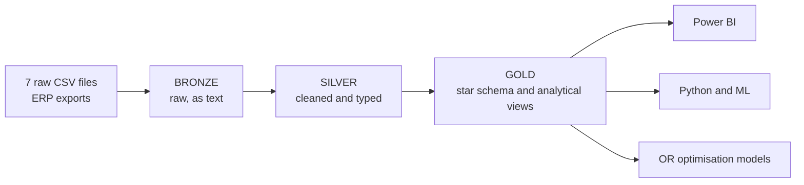
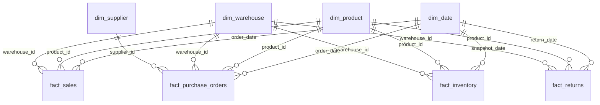

# FMCG Supply Chain Data Warehouse


A SQL Server data warehouse for an FMCG supply chain, built with a **medallion architecture** (Bronze, Silver, Gold). It turns seven raw ERP exports into a clean star schema and a set of analytical views that feed **optimisation models, machine learning, and Power BI dashboards** for supply chain planners.

This repository is the data engineering foundation of the graduation project *AI-Powered Supply Chain Analytics & Decision Intelligence Platform*.

---

## Table of contents

- [Overview](#overview)
- [Architecture](#architecture)
- [Data sources](#data-sources)
- [Repository structure](#repository-structure)
- [Getting started](#getting-started)
- [Data model](#data-model)
- [Gold layer objects](#gold-layer-objects)
- [Data quality](#data-quality)
- [What you can build on top](#what-you-can-build-on-top)
- [Known limitations](#known-limitations)
- [Roadmap](#roadmap)
- [Documentation](#documentation)
- [Author](#author)

---

## Overview

| | |
|---|---|
| **Business domain** | FMCG supply chain: 80 products, 5 distribution centres, 12 suppliers |
| **Period** | September 2025 to August 2026 |
| **Volume** | 6,000 sales orders, 1,800 purchase orders, 10,600 weekly inventory snapshots, 295 returns |
| **Database** | `FMCG_Datawarehouse` on SQL Server LocalDB |
| **Goal** | Give planners trustworthy data for demand forecasting, inventory optimisation, supplier scoring, and risk prediction |

---

## Architecture



| Layer | Schema | What happens here |
|---|---|---|
| **Bronze** | `BRONZE` | Raw files are loaded as text, with no cleaning. This keeps an exact copy of the source. |
| **Silver** | `SILVER` | Data is trimmed, de-duplicated, standardised, converted to real data types, and bad values become `NULL`. Each table has a `dwh_create_date` audit column. |
| **Gold** | `GOLD` | Business-ready **views**: a star schema (`dim_*`, `fact_*`) and model-ready analytical views (`vw_*`). |

---

## Data sources

Seven ERP exports in CSV format:

| File | Bronze and Silver table | Content |
|---|---|---|
| `products_raw.csv` | `ERP_Products` | Product master (category, cost, price, supplier) |
| `suppliers_raw.csv` | `ERP_Suppliers` | Supplier master (country, lead time, reliability) |
| `warehouses_raw.csv` | `ERP_Warehouse` | Distribution centres (location, capacity) |
| `sales_orders_raw.csv` | `ERP_sales_orders` | Customer orders and delivery status |
| `purchase_orders_raw.csv` | `ERP_purchase_orders` | Orders placed with suppliers |
| `inventory_raw.csv` | `ERP_Inventory` | Weekly stock snapshots |
| `returns_raw.csv` | `ERP_Returns` | Product returns with reasons |

---

## Repository structure

Suggested layout. Rename the files to match your scripts.

```
.
├── data/                         # the 7 raw CSV files
├── scripts/
│   ├── 01_init_database.sql      # database and schemas
│   ├── bronze/
│   │   ├── 02_ddl_bronze.sql     # DROP and CREATE raw tables
│   │   └── 03_load_bronze.sql    # BULK INSERT
│   ├── silver/
│   │   ├── 04_ddl_silver.sql     # typed tables with dwh_create_date
│   │   └── 05_load_silver.sql    # cleaning and loading
│   └── gold/
│       ├── 06_gold_star_schema.sql        # dim_* and fact_* views
│       └── 07_gold_analytical_views.sql   # vw_* views
├── docs/
│   └── FMCG_Data_Catalog.md      # full data dictionary
└── README.md
```

---

## Getting started

### Prerequisites

- SQL Server (LocalDB, Express, or Developer) and SQL Server Management Studio
- Power BI Desktop (optional, for dashboards)
- Python 3 with `pandas` and `pyodbc` (optional, for ML)

### Steps

1. **Clone the repository** and copy the CSV files to a simple local path, for example `C:\dataset\`. A short path without OneDrive or non-English characters avoids file access errors with `BULK INSERT`.
2. **Create the database and schemas** (`BRONZE`, `SILVER`, `GOLD`).
3. **Run the Bronze scripts**: create the raw tables, then load the CSV files.
4. **Run the Silver scripts**: create the typed tables, then run the cleaning and load.
5. **Run the Gold scripts**: create the star schema views, then the analytical views.
6. **Verify the load** with the row-count check below.

```sql
SELECT 'dim_date' AS view_name, COUNT(*) AS rows_count FROM GOLD.dim_date
UNION ALL SELECT 'dim_product',          COUNT(*) FROM GOLD.dim_product
UNION ALL SELECT 'dim_supplier',         COUNT(*) FROM GOLD.dim_supplier
UNION ALL SELECT 'dim_warehouse',        COUNT(*) FROM GOLD.dim_warehouse
UNION ALL SELECT 'fact_sales',           COUNT(*) FROM GOLD.fact_sales
UNION ALL SELECT 'fact_purchase_orders', COUNT(*) FROM GOLD.fact_purchase_orders
UNION ALL SELECT 'fact_inventory',       COUNT(*) FROM GOLD.fact_inventory
UNION ALL SELECT 'fact_returns',         COUNT(*) FROM GOLD.fact_returns;
```

Expected counts: 487, 80, 12, 5, 6000, 1800, 10600, 295.

### Loading notes

- Bronze columns **must follow the column order of the CSV**. `BULK INSERT` maps columns by position, not by name.
- On LocalDB, `FORMAT = 'CSV'` failed with OLE DB error 7301, so the classic options are used (`FIELDTERMINATOR`, `ROWTERMINATOR = '0x0a'`, `CODEPAGE = '65001'`).
- Without quote handling, commas inside quoted fields (for example `"Ahmedabad, Gujarat"` or `Nov 10, 2025`) shift the columns. **Silver repairs these rows**, so Bronze stays an untouched copy of the load.

### Connect from Power BI

Get Data, SQL Server, server `(localdb)\MSSQLLocalDB`, database `FMCG_Datawarehouse`. Select the `GOLD` views and use **Import** mode.

### Connect from Python

```python
import pandas as pd, pyodbc

conn = pyodbc.connect(
    "Driver={ODBC Driver 17 for SQL Server};"
    "Server=(localdb)\\MSSQLLocalDB;"
    "Database=FMCG_Datawarehouse;"
    "Trusted_Connection=yes;"
)
demand = pd.read_sql("SELECT * FROM GOLD.vw_demand_weekly", conn)
```

---

## Data model

Star schema of the Gold layer. All relationships are one-to-many from dimension to fact.



Joins use business keys (`product_id`, `supplier_id`, `warehouse_id`) and `dim_date[date]`. Facts with several date columns, such as sales with order, ship and delivery dates, use one active relationship and the others as inactive relationships (`USERELATIONSHIP` in DAX).

---

## Gold layer objects

### Star schema

| Object | Grain | Rows |
|---|---|---|
| `GOLD.dim_date` | one day | 487 |
| `GOLD.dim_product` | one product | 80 |
| `GOLD.dim_supplier` | one supplier | 12 |
| `GOLD.dim_warehouse` | one warehouse | 5 |
| `GOLD.fact_sales` | one sales order | 6,000 |
| `GOLD.fact_purchase_orders` | one purchase order | 1,800 |
| `GOLD.fact_inventory` | product x warehouse x week | 10,600 |
| `GOLD.fact_returns` | one return | 295 |

### Analytical views

| View | Purpose | Grain |
|---|---|---|
| `GOLD.vw_demand_weekly` | Weekly demand series (zero weeks included) for forecasting and bullwhip analysis | product x warehouse x week |
| `GOLD.vw_inventory_policy_inputs` | Demand and lead-time statistics, current stock policy, and a baseline safety stock and reorder point | product x warehouse |
| `GOLD.vw_supplier_scorecard` | On-time rate, delay, lead time, and fill rate per supplier | supplier |
| `GOLD.vw_inventory_risk` | Features and next-week targets for stock-out prediction | product x warehouse x week |

---

## Data quality

The raw data had many intentional quality problems. Silver handles them with documented rules.

| Problem | Example | Handling |
|---|---|---|
| Duplicate rows | 159 in inventory, 90 in sales, 36 in purchase orders | Removed |
| Mixed date formats | `2026-01-02`, `07-04-2026`, `01/20/2026`, `Nov 10, 2025` | Unified to `DATE` |
| Ambiguous slash dates | `MM/DD/YYYY` in order dates, `DD/MM/YYYY` in delivery dates | Interpreted per column and validated (shipping never precedes ordering) |
| Inconsistent text | `apparel`, `APPAREL`, `  Apparel ` | Standardised |
| Impossible values | negative cost, lead time of -1, negative stock | Set to `NULL` |
| Decimals in integer columns | `21.0` | Converted through `DECIMAL`, then `INT` |
| Commas inside fields | `"Ahmedabad, Gujarat"` shifted the columns | Rebuilt in Silver |
| Missing values | empty supplier, delivery date, customer | Kept as `NULL`, never invented |

The principle: **Silver does not guess**. A missing value stays `NULL`, and the decision to fill it belongs to the model that uses it.

---

## What you can build on top

| Module | Uses |
|---|---|
| Demand forecasting (ARIMA, XGBoost, Croston) | `vw_demand_weekly` |
| Bullwhip effect analysis | `vw_demand_weekly` and purchase quantities |
| Safety stock, EOQ, inventory optimisation (MILP), simulation | `vw_inventory_policy_inputs` |
| Supplier ranking (TOPSIS, AHP) | `vw_supplier_scorecard` |
| Stock-out risk classification | `vw_inventory_risk` |
| Executive dashboards | Star schema in Power BI |

---

## Known limitations

- **Inventory covers 200 of 400 product x warehouse pairs** that appear in sales.
- **Demand is intermittent** at product x warehouse level, so aggregate before forecasting.
- **No cost parameters:** holding, ordering, and transport costs do not exist and must be stated as assumptions.
- **Revenue uses list price.** There is one fixed price per product, so price elasticity cannot be estimated.
- **Not supported by the data alone:** vehicle routing (no customer locations), cold-chain optimisation (no shelf life), dynamic pricing.
- Some suppliers are missing lead time or reliability, and some products are missing cost or supplier.

See the [data catalog](docs/FMCG_Data_Catalog.md) for the full list.

---

## Roadmap

- [x] Bronze layer: raw load of 7 tables
- [x] Silver layer: cleaning and typing of all tables
- [x] Gold layer: star schema and analytical views
- [x] Data catalog
- [ ] Referential integrity checks between tables
- [ ] Stored procedures to reload Bronze and Silver in one run
- [ ] Power BI dashboard
- [ ] Forecasting, inventory optimisation, supplier scoring, and risk models

---

## Documentation

- [Data catalog](docs/FMCG_Data_Catalog.md): every view and column, business rules, formulas, and data quality notes.

---

## Author

**Khalid Yousry**
Faculty of Computers and Artificial Intelligence, Cairo University, Operations Research and Decision Support
GitHub: [@khalidyousry](https://github.com/khalidyousry)
